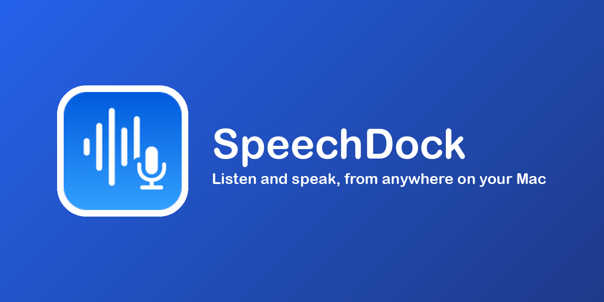
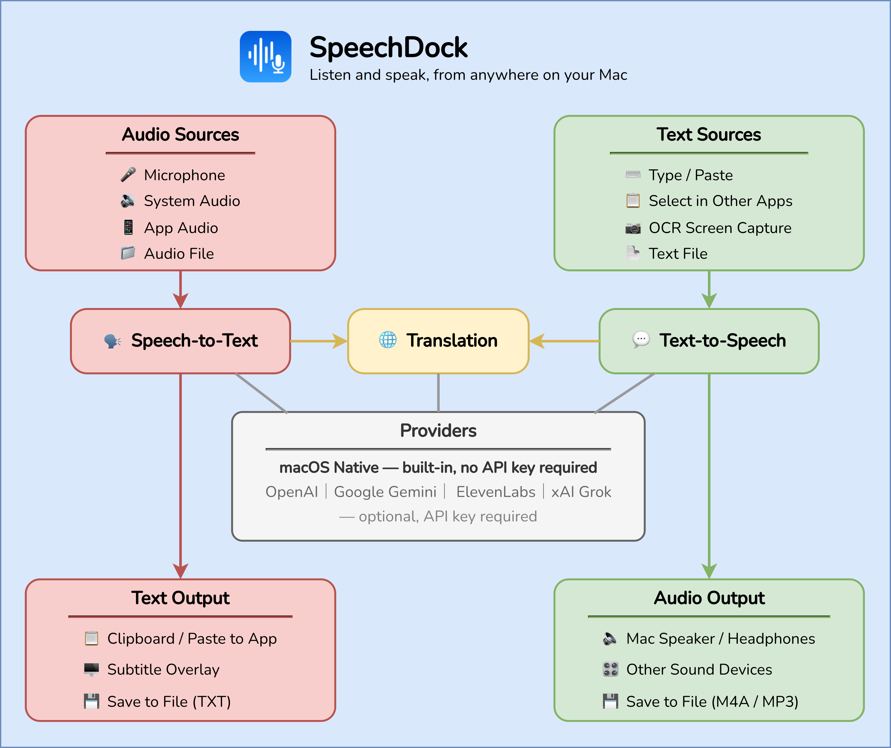

<p align="center">
  
</p>

<p align="center">
  
  
  <a href="LICENSE"></a>
  <a href="https://github.com/yohasebe/speechdock/releases"></a>
  
</p>

## SpeechDockとは？

**Macのあらゆる音声をテキストに** — マイクからの声だけでなく、システム全体の音声や特定アプリの音声もキャプチャ可能。Macが聞ける音なら、SpeechDockがリアルタイムで文字起こしします。

**画面上のあらゆるテキストを音声に** — 選択テキスト、直接入力、ペースト、画面からのOCRキャプチャ。見えるテキストなら、SpeechDockが読み上げます。

**リアルタイム字幕と翻訳** — 文字起こしを画面上に字幕としてリアルタイム表示。オンデバイスまたはクラウドプロバイダを使って100以上の言語への翻訳にも対応。

**メニューバーからいつでもアクセス** — グローバルホットキーで、アプリを切り替えることなくどこからでも利用可能。インストール後すぐに使え、APIキーは不要です。クラウドプロバイダはオプションで追加できます。

[English](README.md) | 日本語

## アーキテクチャ

<p align="center">
  
</p>

## ドキュメント

| ページ | 内容 |
|--------|------|
| **[ホーム](https://yohasebe.github.io/speechdock/index_ja.html)** | 概要とはじめに |
| **[基本機能](https://yohasebe.github.io/speechdock/basics_ja.html)** | macOSネイティブSTT/TTS、OCR、字幕、ショートカット |
| **[高度な機能](https://yohasebe.github.io/speechdock/advanced_ja.html)** | クラウドプロバイダ、APIキー、ファイル文字起こし、翻訳 |
| **[AppleScript](https://yohasebe.github.io/speechdock/applescript_ja.html)** | スクリプトコマンド、プロパティ、例、エラーコード |

## 機能

### 音声認識（STT）

以下のプロバイダで音声をテキストに変換できます：

| プロバイダ | モデル | APIキー |
|----------|--------|---------|
| **macOS Native** | System Default（macOS 26+ではSpeechAnalyzer） | 不要 |
| **OpenAI** | GPT Realtime Whisper, GPT-4o Mini Transcribe, Whisper | 必要 |
| **Google Gemini** | Gemini 3.5 Transcribe Live、Gemini 3.8 Live | 必要 |
| **ElevenLabs** | Scribe v2 Realtime | 必要 |
| **Grok** | Grok STT | 必要 |

**注意**: macOS 26+では、ネイティブSTTはAppleの新しいSpeechAnalyzerフレームワークを使用し、時間制限なしのリアルタイム文字起こしと高いパフォーマンスを提供します。

### 音声合成（TTS）

以下のプロバイダでテキストを音声に変換できます：

| プロバイダ | モデル | APIキー |
|----------|--------|---------|
| **macOS Native** | System Default | 不要 |
| **OpenAI** | GPT-4o Mini TTS (Dec 2025) | 必要 |
| **Google Gemini** | Gemini 3.8 Flash TTS（既定）, Gemini 3.8 Flash-Lite TTS — 表現豊か、多言語対応 | 必要 |
| **ElevenLabs** | Eleven v3, Flash v2.5 | 必要 |
| **Grok** | Grok TTS — 26音声、25以上の言語対応 | 必要 |

Gemini TTS の再生速度は0.5〜2.0倍に調整できます。保存音声は元の速度を保ちます。

**音声タグ**: Gemini 3.8、Grok TTS、ElevenLabs v3 は `[whispers]`、`[laughs]`、`[excited]` などのインラインタグや、Grokの `<whisper>...</whisper>`、`<slow>...</slow>` などのラップタグをサポートしています。タグはTTSパネルのテキストに直接記述できます。空のパネルに表示される "Reference" リンクから各プロバイダの公式タグ一覧にアクセスできます。

### OCR読み上げ

画面の任意の領域からテキストをキャプチャして音声に変換します：

1. OCRホットキー（デフォルト: `Ctrl + Option + Shift + O`）を押す
2. ドラッグしてテキストを含む領域を選択
3. 認識されたテキストがTTSパネルに表示され、編集可能
4. 読み上げボタンを押してテキストを音声で再生

macOS Vision Frameworkを使用してテキスト認識を行います。画面収録権限が必要です。

### 字幕モード

録音中にリアルタイム文字起こしを字幕オーバーレイとして表示します：

- **画面上の字幕** - 画面上の任意の場所にフローティング字幕として文字起こしを表示
- **リアルタイム翻訳** - 話しながら字幕を翻訳（オプション）
- **カスタマイズ可能な外観** - フォントサイズ、透明度、位置（上/下）、最大行数を調整可能
- **ドラッグ可能な位置** - 上端のつまみをドラッグして字幕を画面上の任意の位置に移動
- **パネル自動非表示** - 字幕モード有効時にSTTパネルを自動的に非表示にするオプション

ホットキー（デフォルト: `Ctrl + Option + S`）またはSTTパネル/メニューバーから切り替えます。

### オーディオソース

- **マイク** - 接続されたマイクデバイスから録音（デバイス選択可能）
- **システムオーディオ** - Mac全体の音声出力をキャプチャ
- **アプリオーディオ** - 特定のアプリケーションの音声をキャプチャ

### クイック入力（フローティングマイクボタン）

STTパネルを開かずに音声入力を行うフローティングマイクボタン：

1. メニューバーから **Floating Mic Button** を有効化
2. ボタンをクリック、または `Ctrl + Option + M` で録音開始
3. 話す — リアルタイムで文字起こしがフローティングHUDに表示
4. 再度クリック、または `Ctrl + Option + M` で録音停止
5. 文字起こしテキストが最前面のアプリに自動ペースト

ボタンは画面上の任意の場所にドラッグでき、位置は保存されます。

### その他の機能

- STT/TTS用のグローバルキーボードショートカット
- モディファイアキー対応のカスタマイズ可能なパネルショートカット
- リアルタイム文字起こし用パネルウィンドウ（貼り付け先選択機能付き）
- TTS用パネルウィンドウ（テキスト編集・単語ハイライト機能付き）
- パネルスタイル選択: フローティング（最前面固定）または標準ウィンドウ
- TTS用オーディオ出力デバイス選択
- 合成音声のファイル保存（M4A/MP3形式）
- STT/TTS用言語選択
- TTS再生速度調整
- プロバイダごとの音声・モデル選択
- VAD（音声検出）による自動録音停止（ハンズフリー操作）
- STT出力のテキスト置換ルール
- 翻訳（macOSオンデバイスまたはクラウドLLM）
- 文字起こし履歴（自動保存、最大50件、メニューバーからアクセス）
- TTS パネルへのテキストファイルのドロップ（.txt、.md、.text、.rtf、最大1 MB）。UTF-8 の本文または RTF のテキストを落とした位置に挿入し、Cmd + Z で元に戻せます。
- リアルタイム文字数・単語数カウント表示
- WebSocket自動再接続（指数バックオフ）
- [AppleScriptサポート](docs/applescript_ja.md)（自動化用）
- 翻訳操作は本文の下に折りたたみ表示し、ファイル文字起こしは既存の本文へ追記します。設定でショートカットの問題を確認でき、支援設定とキーボードフォーカスに対応します。
- AppleScriptのパネルtoggleは表示だけを切り替えます。hideで停止・非表示にでき、字幕の停止は表示を残します。
- Sparkleによる自動アップデート
- ログイン時に起動オプション

## 必要環境

- macOS 14.0（Sonoma）以降
- Apple Silicon Mac（M1/M2/M3/M4）
- クラウドプロバイダ用APIキーは**オプション**（OpenAI、Google Gemini、ElevenLabs、Grokを使用する場合のみ必要）

## インストール

### Homebrew（推奨）

```bash
brew tap yohasebe/speechdock
brew install --cask speechdock
```

最新バージョンへの更新：

```bash
brew upgrade --cask speechdock
```

### 手動ダウンロード

1. [Releases](https://github.com/yohasebe/SpeechDock/releases)ページから最新の`.dmg`ファイルをダウンロード
2. DMGファイルを開く
3. SpeechDockをアプリケーションフォルダにドラッグ
4. アプリケーションからSpeechDockを起動

## セットアップ

### APIキー

クラウドプロバイダを使用するには、APIキーの設定が必要です：

1. **設定** > **API Keys** を開く
2. APIキーを入力：
   - **OpenAI**: [OpenAI Platform](https://platform.openai.com/api-keys)
   - **Google Gemini**: [Google AI Studio](https://aistudio.google.com/apikey)
   - **ElevenLabs**: [ElevenLabs Settings](https://elevenlabs.io/app/settings/api-keys)
   - **Grok (xAI)**: [xAI Console](https://console.x.ai/)

APIキーはmacOSキーチェーンに安全に保存されます。各欄には 1Password の参照（`op://保管庫/項目/フィールド`）も書けます。1Password CLI で読み込みます。詳しくは [高度な機能](https://yohasebe.github.io/speechdock/advanced_ja.html#1password-references) を参照してください。環境変数も使えます（`OPENAI_API_KEY`、`GEMINI_API_KEY`、`ELEVENLABS_API_KEY`、`XAI_API_KEY`。古い名前の `GROK_API_KEY` も受け付けます）。

保存した翻訳プロバイダが使えない場合は、パネルと字幕の表示・翻訳動作を同じ利用可能なプロバイダに切り替え、「API キー未設定」などの理由を表示します。macOS 翻訳ではクラウドモデル欄を表示しません。保存したプロバイダの設定は維持します。

### 権限

権限は、その機能を使うときにだけ必要です。読み上げにマイクの許可は必要ありません。

| 権限 | 用途 |
|------|------|
| **マイク** | マイクからの音声入力 |
| **アクセシビリティ** | 選択テキストの取得と、ほかのアプリへのテキスト挿入 |
| **画面収録** | システム・アプリ音声の取り込み、OCR、ウィンドウのサムネイル |

権限を許可せずに「続ける」や「後で」を選べます。この選択は記憶され、起動のたびにセットアップは表示されません。メニューバーの「権限...」から再び確認できます。権限が不足している機能を使おうとすると、必要な許可を案内します。マイクは未要求・拒否・制限・許可済みを区別して表示します。画面収録とアクセシビリティは利用可能かどうかを表示します（macOS は拒否の履歴を公開していません）。**システム設定 > プライバシーとセキュリティ**で画面収録を許可しても利用できない場合は、SpeechDock を再起動してください。

STT/TTS パネル、設定、権限セットアップのいずれかが開いている間は Dock に表示され、すべて閉じるとメニューバー常駐に戻ります。字幕、クイックマイクなどの補助表示だけでは Dock に表示されません。

## 使い方

### キーボードショートカット

| アクション | デフォルト |
|-----------|-----------|
| 録音開始/停止（STT） | `Cmd + Shift + Space` |
| 選択テキストを読み上げ（TTS） | `Ctrl + Option + T` |
| OCR領域を読み上げ | `Ctrl + Option + Shift + O` |
| 字幕モード切り替え | `Ctrl + Option + S` |
| クイック入力 | `Ctrl + Option + M` |

ショートカットは **設定** > **Shortcuts** でカスタマイズできます。

### STTパネル

| アクション | デフォルト |
|-----------|-----------|
| 録音 | `Cmd + R` |
| 録音停止 | `Cmd + S` |
| テキスト貼り付け | `Cmd + Return` |
| 貼り付け先選択 | `Cmd + Shift + Return` |
| キャンセル | `Cmd + .` |

### TTSパネル

| アクション | デフォルト |
|-----------|-----------|
| 読み上げ | `Cmd + Return` |
| 停止 | `Cmd + .` |
| 音声保存 | `Cmd + S` |

### メニューバー

メニューバーのSpeechDockアイコンをクリックして以下にクイックアクセス：

- STT録音の開始/停止
- 選択テキストのTTSを開く
- 字幕モードとフローティングマイクボタンの切替
- 音声ファイルの文字起こし
- 文字起こし履歴の閲覧
- OCR読み上げ
- 設定、ヘルプ、Aboutにアクセス

## 設定

### 設定項目

`Cmd + ,` またはメニューバーから設定を開きます。統合設定ウィンドウはサイドバーで以下のカテゴリに分かれています：

- **音声認識**: プロバイダ、モデル、言語、音声入力、自動停止、パネル動作
- **音声合成**: プロバイダ、モデル、音声、速度、音声出力、パネル動作
- **翻訳**: パネル翻訳プロバイダ/モデル、字幕翻訳設定
- **字幕**: オン/オフ、位置、フォントサイズ、テキスト/背景の不透明度、最大行数
- **ショートカット**: グローバルホットキーとパネルショートカット
- **テキスト置換**: 組み込みパターンとカスタムルール
- **外観**: テキストフォントサイズ、パネルスタイル、ログイン時に起動
- **APIキー**: クラウドプロバイダのAPIキー（オプション）
- **About**: バージョン情報、リンク、アップデートの確認、サポート

### パネルスタイル

**設定** > **外観** で2つのパネルスタイルから選択できます：

- **Floating**: 最前面固定のボーダーレスパネル。上端のつまみをドラッグして移動
- **Standard Window**: 通常のmacOSウィンドウ。タイトルバーをドラッグして移動でき、最小化も可能

注: STTパネルとTTSパネルは同時に開けません。一方を開くともう一方は自動的に閉じます。

## トラブルシューティング

### STTが動作しない

1. マイク権限が付与されているか確認
2. APIキーが設定されているか確認（クラウドプロバイダの場合）
3. macOS Nativeプロバイダで基本機能をテスト
4. システム/アプリオーディオの場合、画面収録権限を確認

### TTSが動作しない

1. APIキーが設定されているか確認（クラウドプロバイダの場合）
2. macOS Nativeプロバイダでテスト
3. オーディオ出力がミュートになっていないか確認
4. 別の出力デバイスを選択してみる

### ショートカットが反応しない

1. アクセシビリティ権限が付与されているか確認
2. 他のアプリケーションとの競合を確認
3. 設定でショートカットをデフォルトにリセット

### システムオーディオ/アプリオーディオが動作しない

1. システム設定で画面収録権限を付与
2. アプリオーディオの場合、対象アプリが実行中か確認
3. オーディオソースメニューからアプリリストを更新

### OCRが動作しない

1. システム設定で画面収録権限を付与
2. 選択した領域のテキストが鮮明で読みやすいか確認
3. テキスト周辺のより広い領域を選択してみる

## プライバシーとセキュリティ

- **APIキー**: macOSキーチェーンに安全に保存され、各プロバイダへの送信以外には使用されません
- **macOS Native**: 音声は完全にデバイス上で処理され、外部に送信されません
- **クラウドプロバイダ**: 音声はプロバイダのAPI（OpenAI、Google、ElevenLabs、Grok）に送信され、各社のプライバシーポリシーに従って処理されます
- **テレメトリなし**: SpeechDockは使用データの収集・送信を行いません

## ライセンス

Apache License 2.0 - 詳細は[LICENSE](LICENSE)を参照してください。

## 作者

長谷部陽一郎

## 開発を支援

SpeechDock は無料のオープンソースソフトウェアです。お役に立てていれば、開発の継続をご支援いただけると幸いです。

- [GitHub Sponsors](https://github.com/sponsors/yohasebe)
- [Buy Me a Coffee](https://buymeacoffee.com/yohasebe)
- [Ko-fi](https://ko-fi.com/yohasebe)

## コントリビュート

コントリビュートを歓迎します！ガイドラインは[CONTRIBUTING.md](CONTRIBUTING.md)を参照してください。

