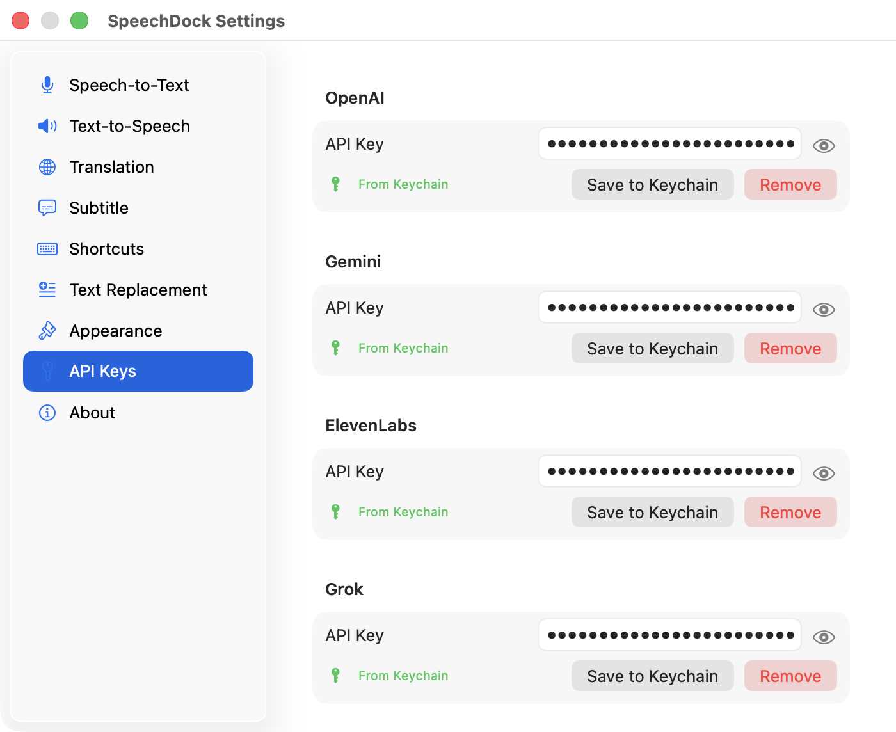
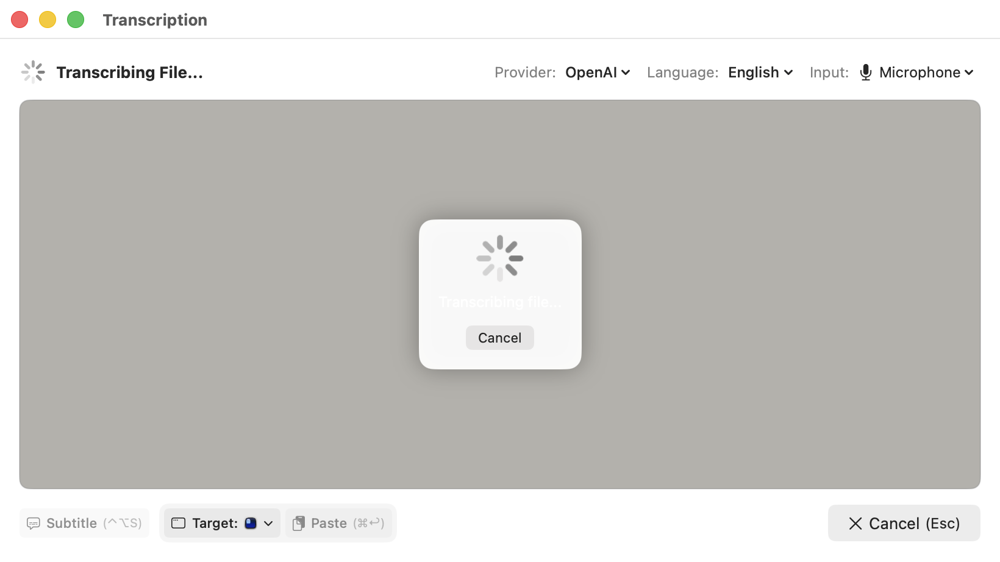

<a href="advanced_ja.html">日本語</a>

# SpeechDock — Advanced Features

This page covers features that require API keys from cloud providers. These are optional enhancements — SpeechDock works fully with macOS native STT/TTS without any API keys.

## API Key Setup

<figure>
  
  <figcaption>Settings — API Keys tab for configuring cloud provider credentials</figcaption>
</figure>

To use cloud providers, configure API keys in **Settings** > **API Keys**:

| Provider | Get API Key | Environment Variable |
|----------|-------------|---------------------|
| **OpenAI** | [OpenAI Platform](https://platform.openai.com/api-keys) | `OPENAI_API_KEY` |
| **Google Gemini** | [Google AI Studio](https://aistudio.google.com/apikey) | `GEMINI_API_KEY` |
| **ElevenLabs** | [ElevenLabs Settings](https://elevenlabs.io/app/settings/api-keys) | `ELEVENLABS_API_KEY` |
| **Grok (xAI)** | [xAI Console](https://console.x.ai/) | `XAI_API_KEY` (`GROK_API_KEY` also accepted) |

API keys are securely stored in macOS Keychain. Alternatively, you can set environment variables for development. Grok also accepts the older name `GROK_API_KEY`; `XAI_API_KEY` is used when both are set, and saving a Grok key in Settings stores it as `XAI_API_KEY` and removes the item saved under the older name.

### 1Password References
{: #1password-references }

Instead of the key itself, a field (or an environment variable) can hold a 1Password secret reference such as `op://Private/OpenAI/credential`. SpeechDock reads it with the [1Password CLI](https://developer.1password.com/docs/cli/) (`op`), found on your `PATH`, in `/opt/homebrew/bin` or in `/usr/local/bin`.

Setup, on each Mac that runs SpeechDock (the CLI is not synced with your 1Password settings):

1. Install the CLI. It is separate from the 1Password app, which alone is not enough: `brew install --cask 1password-cli`
2. In the 1Password app, turn on **Settings** > **Developer** > **Integrate with 1Password CLI**. SpeechDock reads references through this integration; when it is off, reading usually fails as "not signed in".
3. To check a reference without showing the key, run in a terminal: `op read "op://Private/OpenAI/credential" >/dev/null && echo OK`

- Only the reference is stored in the Keychain. The value it reads to stays in SpeechDock's memory until it quits and is never written to disk or logs.
- All references are read together, with one approval, when **Settings** > **API Keys** opens or when a key is first needed. Starting SpeechDock (for example at login) does not ask for approval.
- If a reference cannot be read (op not installed, not signed in, approval declined, item not found), that provider is treated as having no key, and Settings shows the reason. Use **Reload from 1Password** to try again; a declined approval is not asked again until you do.
- If a provider rejects a key read from a reference (HTTP 401 or 403), the reference is read again the next time the key is used, once.
- SpeechDock runs `op` only if it is signed by 1Password; otherwise the reference fails with "1Password CLI (op) could not be verified".
- `op` is started as its own process for macOS privacy purposes, as when you run it in a terminal, so it can reach the 1Password app. On a macOS version where this is not possible, references may fail with "not signed in".

## Cloud STT Providers

Cloud providers offer higher accuracy, more language support, and specialized features compared to macOS native STT.

| Provider | Models | Features |
|----------|--------|----------|
| **OpenAI** | GPT Realtime Whisper, GPT Live Transcribe, GPT Transcribe | Streaming deltas (Whisper), high accuracy, 100+ languages |
| **Google Gemini** | Gemini 3.5 Transcribe Live, Gemini 3.8 Live | Streaming speech-to-text; file transcription uses Gemini 3.8 Flash |
| **ElevenLabs** | Scribe v2 Realtime | Low latency, natural punctuation |
| **Grok** | Grok STT | xAI's dedicated streaming speech-to-text |

Select the provider in **Settings** > **Speech-to-Text**.

## Cloud TTS Providers

Cloud TTS provides natural-sounding voices with various styles and languages.

| Provider | Models | Voices |
|----------|--------|--------|
| **OpenAI** | GPT-4o Mini TTS (Dec 2025) | alloy, echo, fable, onyx, nova, shimmer |
| **Google Gemini** | Gemini 3.8 Flash TTS (default), Gemini 3.8 Flash-Lite TTS | 30 multilingual voices (Zephyr, Kore, Puck, etc.) |
| **ElevenLabs** | Eleven v3, Eleven Flash v2.5 | Large voice library |
| **Grok** | Grok TTS | 26 voices including eve, ara, rex, sal and leo (25+ languages, auto-detected) |

Gemini TTS playback speed can be adjusted from 0.5–2.0x. Saved audio retains its original pace.

### Voice Tags (Expressive Markup)

Some providers support inline voice tags that control delivery (laughter, whispers, pauses, etc.). Tags are typed directly in the TTS panel alongside the text.

| Provider | Inline tags | Wrapping tags | Example |
|----------|-------------|---------------|---------|
| **Gemini 3.8 TTS** | `[whispers]`, `[excited]`, `[sighs]`, `[laughs]`, `[sarcastic]`, `[crying]`, `[tired]`, etc. | — | `Welcome! [excited] Let's go.` |
| **Grok TTS** | `[pause]`, `[long-pause]`, `[laugh]`, `[sigh]`, `[gulp]`, `[inhale]`, `[exhale]` | `<soft>`, `<loud>`, `<slow>`, `<fast>`, `<whisper>`, `<sing>` | `I have <whisper>a secret</whisper>.` |
| **ElevenLabs v3** | `[laughs]`, `[sighs]`, `[whispers]`, `[excited]`, `[tired]`, etc. | — | `That was hilarious! [laughs]` |

The empty-state TTS panel placeholder includes a "Reference" link to each provider's official tag documentation.

### Voice and Model Selection

Each provider offers different voices and models. Select them in:
- **Settings** > **Text-to-Speech** (persistent setting)
- **TTS Panel** header (quick switch)

### Audio Output Device

Route TTS playback to any audio output device (speakers, headphones, virtual devices). Select in **Settings** > **Text-to-Speech** or the TTS panel.

## Audio File Transcription

<figure>
  
  <figcaption>File Transcription — Drag and drop audio files to transcribe</figcaption>
</figure>

Transcribe pre-recorded audio files. Available with cloud STT providers and macOS native (macOS 26+). Not available with Grok provider.

| Provider | Formats | Max Size | Max Duration | API |
|----------|---------|----------|--------------|-----|
| **macOS** (26+) | MP3, WAV, M4A, AAC, AIFF, FLAC, MP4 | 100 MB | No limit | SpeechAnalyzer; system recognition fallback |
| **OpenAI** | MP3, WAV, M4A, FLAC, WebM, OGG, MP4 | 25 MB | Unlimited | GPT Transcribe |
| **Gemini** | MP3, WAV, AAC, OGG, FLAC | 14 MB | ~10 min | generateContent |
| **ElevenLabs** | MP3, WAV, M4A, OGG, FLAC | 25 MB | ~2 hours | Scribe v2 |

**Note**: macOS file transcription requires macOS 26 or later and no API key. SpeechAnalyzer processes supported languages on-device; fallback recognition may use Apple’s servers and require an internet connection.

### How to Transcribe

**Drag & Drop**: Drag an audio file onto the STT panel's text area.

**Menu Bar**: Select **Transcribe Audio File...** from the SpeechDock menu bar.

The STT panel placeholder displays the supported formats and limits for the currently selected provider.

## Translation with External Providers

While macOS on-device translation supports ~18 languages, cloud providers offer:
- 25+ languages (all languages in the language list)
- Higher translation quality using LLMs
- Works on macOS 14+ (no macOS 26 requirement)

### Translation Providers and Models

| Provider | Models | Notes |
|----------|--------|-------|
| **macOS** (default) | System | On-device, no API key, macOS 26+ |
| **OpenAI** | GPT-5.4 Mini (default), GPT-6 Luna | Fast, high quality |
| **Gemini** | Gemini 3.5 Flash Lite (default), Gemini 3.1 Pro (Preview) | Fast, multilingual |
| **Grok** | Grok 4.20 Fast (default), Grok 4.20 Fast (Reasoning) | Fast translation |

### Switching Translation Provider

- **Settings** > **Translation**: Set the default provider and model
- **Panel**: Click the `⚡` button next to the translation controls for quick switching

### Translation Provider Selection

The translation provider is independent of STT and TTS. Changing a speech provider does not change the translation provider. Choose it in Settings or the translation controls.

When the saved translation provider cannot be used, the panel and subtitles show and use the same available provider, with a short reason such as “API key not set.” macOS translation hides the cloud model selector. Your saved preference is retained.

## Subtitle Real-time Translation

When using subtitle mode, you can enable real-time translation that translates speech as you speak. This works with all audio sources (microphone, system audio, app audio).

### How It Works

1. Enable subtitle mode (`Ctrl + Option + S`)
2. Click the globe icon (🌐) in the subtitle header to enable translation
3. Select your target language and translation provider
4. Start recording — translations appear in real-time

### Translation Providers for Subtitles

| Provider | Debounce | Best For |
|----------|----------|----------|
| **macOS** | 200ms | Fast, local, privacy-focused |
| **OpenAI** | 400ms | High quality, many languages |
| **Gemini** | 350ms | Good balance of speed and quality |
| **Grok** | 350ms | Fast translation |

**Note**: Subtitle translation uses the provider's default model for optimal performance. This is independent of the model selected in the panel translation settings.

### Features

- **Caching** — Repeated phrases are translated instantly from cache (up to 200 entries)
- **Context-aware** — LLM providers use recent sentences as context for better translations
- **Pause detection** — Automatically triggers translation after 1.5 seconds of silence
- **Settings sync** — Translation settings sync from the STT panel when subtitle mode starts

### Limitations

- Translation adds some latency compared to transcription-only mode
- Cloud providers require API keys and internet connection
- macOS provider requires macOS 26+ and downloaded language packs

## Language Selection

Cloud STT supports automatic detection or a supported language selection. Cloud TTS generally detects the language from the text; the manual TTS language picker is available for ElevenLabs.

## TTS Speed Control (Save Audio)

When saving audio to a file, speed is controlled differently from real-time playback:

| Provider | Parameter | Range | Notes |
|----------|-----------|-------|-------|
| OpenAI | — | — | GPT-4o Mini TTS has no speed parameter; speed is applied locally during playback |
| ElevenLabs | `voice_settings.speed` | 0.7–1.2 | Mapped from app range |
| Gemini | — | 0.5–2.0 (playback) | Gemini 3.8 TTS uses local playback rate only; saved audio retains its original pace. No pace instructions are added to the text |
| macOS | Words per minute | 50–500 | Based on 175 wpm baseline |
| Grok | — | — | No speed parameter; wrap text with `<slow>...</slow>` or `<fast>...</fast>` for pacing |

For real-time playback, speed is controlled locally via audio processing for providers that support it, allowing dynamic adjustment during playback. Providers without an API speed parameter (OpenAI GPT-4o Mini TTS, Grok TTS) disable the speed slider.

## Privacy Considerations

When using cloud providers:
- Audio data is sent to the respective provider's API for processing
- Each provider has its own privacy policy and data retention rules
- For maximum privacy, use macOS native providers (all processing on-device)
- API keys are stored in macOS Keychain and never shared between providers

### Panels, files, and accessibility

Translation is an optional, collapsible section below the text. Speech controls remain separate. Settings can be widened; model descriptions appear below their short names. Tab navigation keeps its focus indication. The quick microphone supports accessibility activation and shows a one-time click/drag hint; Reduce Motion disables its pulse. Panels use a system material, with opaque backgrounds when Reduce Transparency or Increase Contrast is enabled.

File transcription appends to the existing draft. An empty recognition result leaves it unchanged. The chooser and drop areas accept MP3, WAV, M4A, AAC, AIFF/AIF, WebM, OGG, FLAC, and MP4, except AAC and AIFF/AIF with OpenAI; decoding still depends on the chosen provider. Local macOS transcription allows up to 100 MB with no duration limit. Cloud providers retain their displayed size limits. Speech recognition downloads its initial language model before opening the microphone, shows progress separately, and can be cancelled.

Stopping subtitles keeps the overlay and its text visible. Use Close to remove it. Alerts and save dialogs attach to the active window. Window positions are fitted to connected displays after a display change. If an automatic paste cannot be confirmed, SpeechDock leaves the text on the clipboard and says so. Shortcut registration failures and duplicate panel shortcuts appear in Settings.

### Spaces and full screen

Subtitles, the quick microphone, its HUD, the shortcut panel, and the menu open on the current Space and can accompany another app in full screen. They do not appear on every Space. Open or invoke a tool again to bring it to the active Space. Editable STT/TTS panels activate SpeechDock and show its Dock icon; opening them from another app’s full screen moves to a normal desktop Space. Settings and ordinary window-style panels follow normal macOS window behavior. OCR captures the selected display region using ScreenCaptureKit.

---

**Previous**: [Basic Features](basics.md) | **Next**: [AppleScript Automation](applescript.md)
