
<a href="basics.html">English</a>

# SpeechDock — 基本機能

SpeechDockは、macOSのTTS/STTをより柔軟で使いやすくします。macOSには強力な音声認識・音声合成エンジンが搭載されていますが、手軽に活用する手段がありませんでした。SpeechDockがこの問題を解決します — メニューバーに常駐し、Macのどこからでもアクセスできます。

インストール後すぐに使用でき、APIキーは不要です。初回は言語モデルのダウンロードが必要になる場合があります。

## インストール

1. [Releases](https://github.com/yohasebe/SpeechDock/releases)ページから最新の`.dmg`ファイルをダウンロード
2. DMGファイルを開き、SpeechDockをアプリケーションフォルダにドラッグ
3. アプリケーションからSpeechDockを起動

### 動作環境

- macOS 14.0 (Sonoma) 以降
- Apple Silicon Mac (M1/M2/M3/M4)

### 権限

権限は、その機能を使うときにだけ必要です。読み上げにマイクの許可は必要ありません。

| 権限 | 用途 |
|------|------|
| **マイク** | マイクからの音声入力 |
| **アクセシビリティ** | 選択テキストの取得と、ほかのアプリへのテキスト挿入 |
| **画面収録** | システム・アプリ音声の取り込み、OCR、ウィンドウのサムネイル |

権限を許可せずに「続ける」や「後で」を選べます。この選択は記憶され、起動のたびにセットアップは表示されません。メニューバーの「権限...」から再び確認できます。権限が不足している機能を使おうとすると、必要な許可を案内します。マイクは未要求・拒否・制限・許可済みを区別して表示します。画面収録とアクセシビリティは利用可能かどうかを表示します（macOS は拒否の履歴を公開していません）。**システム設定 > プライバシーとセキュリティ**で画面収録を許可しても利用できない場合は、SpeechDock を再起動してください。

STT/TTS パネル、設定、権限セットアップのいずれかが開いている間は Dock に表示され、すべて閉じるとメニューバー常駐に戻ります。字幕、クイックマイクなどの補助表示だけでは Dock に表示されません。

## 音声認識 (STT)

<figure>
  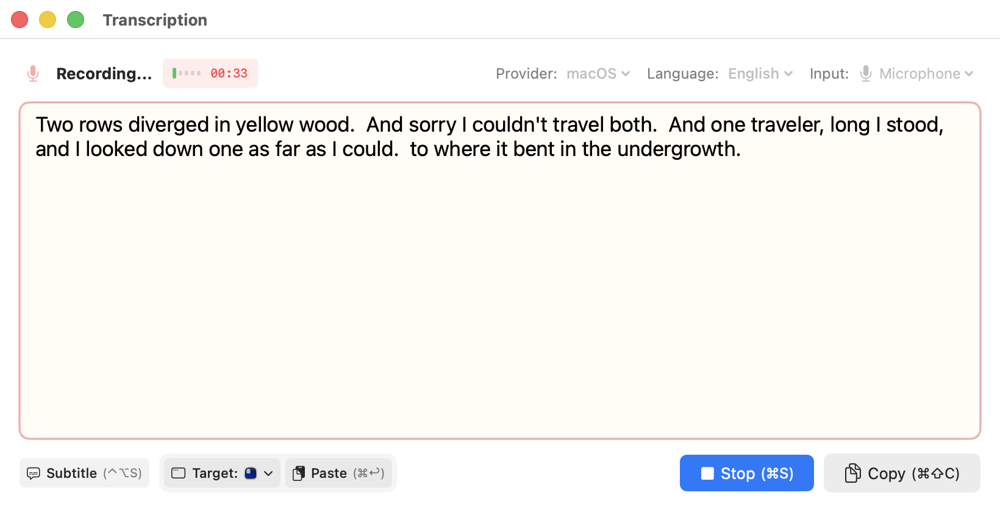
  <figcaption>STTパネル — 複数の音声ソースに対応したリアルタイム音声認識</figcaption>
</figure>

内蔵のmacOS音声認識エンジンを使用して音声をテキストに変換します。APIキーは不要です。

- macOS 14–15: AppleのSFSpeechRecognizerを使用（60秒間隔で自動再起動）
- macOS 26以降: SpeechAnalyzerフレームワークを使用（時間制限なし、精度向上）

### 音声ソース

| ソース | 説明 | 要件 |
|--------|------|------|
| **マイク** | 接続されたマイクから録音 | マイク権限 |
| **システム音声** | Macからのすべての音声出力をキャプチャ | 画面収録権限 |
| **アプリ音声** | 特定のアプリケーションからの音声をキャプチャ | 画面収録権限 |

### STTパネル

グローバルホットキー（デフォルト: `Cmd + Shift + Space`）またはメニューバーからSTTパネルを開きます。

| 操作 | ショートカット |
|------|----------------|
| 録音 / 停止 | `Cmd + R` / `Cmd + S` |
| ターゲットにペースト | `Cmd + Return` |
| ペースト先を選択 | `Cmd + Shift + Return` |
| キャンセル | `Cmd + .` |

<figure>
  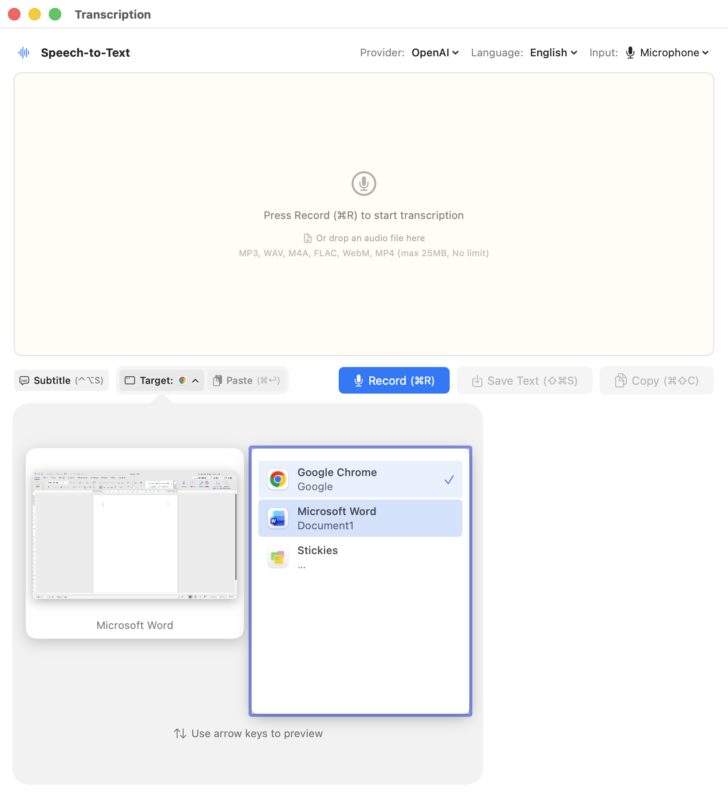
  <figcaption>ペースト先の選択 — 文字起こしテキストを受け取るアプリケーションを選択</figcaption>
</figure>

**自動録音開始**: 設定で有効にすると、STTパネルを開いた直後に録音が開始されます。

### VAD（音声区間検出）

無音を検出すると自動的に録音を停止します：

- **最小録音時間**: VADが有効になるまでの録音時間（デフォルト: 10秒）
- **無音時間**: 停止するまでの無音の長さ（デフォルト: 3秒）

**設定** > **音声認識**で設定します。

## 音声合成 (TTS)

<figure>
  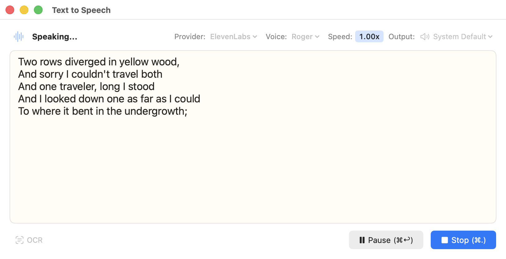
  <figcaption>TTSパネル — 速度調整と音声保存機能付きのテキスト読み上げ</figcaption>
</figure>

内蔵のmacOS音声合成を使用してテキストを音声に変換します。APIキーは不要です。

### TTSパネル

グローバルホットキー（デフォルト: `Ctrl + Option + T`）またはメニューバーからTTSパネルを開きます。

| 操作 | ショートカット |
|------|----------------|
| 再生 / 停止 | `Cmd + Return` / `Cmd + .` |
| 音声を保存 | `Cmd + S` |

**入力方法**:
- パネルに直接テキストを入力
- 他のアプリでテキストを選択し、TTSホットキーを押す（選択テキストを自動キャプチャ）
- OCRを使用して画面からテキストをキャプチャ

**テキストファイル**: `.txt`、`.md`、`.text`、`.rtf`（最大1 MB）を本文やパネルの外周にドロップすると、既存の本文を残して、落とした位置に内容を挿入します。`Cmd + Z` で元に戻せます。プレーンテキストは UTF-8 で保存してください。読めない形式や対応外のファイルはエラーを表示し、パスは挿入しません。

**自動再生**: 有効にすると、パネルを開いたときにキャプチャしたテキストを自動的に読み上げます。

### 速度調整

TTSパネルのスライダーで再生速度を0.5倍から2.0倍に調整できます。再生中でもリアルタイムで速度変更が適用されます。

### 音声を保存

`Cmd + S`を押すか、保存ボタンをクリックして合成音声をファイルに保存します。テキストは5文字以上必要です。

## OCR読み上げ

<figure>
  
  <figcaption>OCR選択 — テキスト認識のための画面領域をドラッグで選択</figcaption>
</figure>

画面の任意の領域からテキストをキャプチャし、TTSパネルに送信します：

1. OCRホットキー（デフォルト: `Ctrl + Option + Shift + O`）を押す
2. テキストを含む領域をドラッグして選択
3. 認識されたテキストがTTSパネルに表示される
4. 必要に応じて編集し、再生を押す

テキスト認識にはmacOS Vision Frameworkを使用します。

## ライブOCR字幕

Netflix、YouTube、ローカルのプレーヤーなど、動画の字幕を表示されるそばから読み上げます。別の言語に翻訳して読み上げることもできます：

1. ライブOCRホットキー（デフォルト: `Ctrl + Option + Shift + L`）を押すか、メニューの **ライブ字幕** から **画面の字幕を読み取る…** を選ぶ
2. 字幕が表示される領域をドラッグして選択（オレンジの点線枠で示されます）
3. 新しい行が表示されるたびに読み上げます。画面下部のバーには状態（監視中はオレンジ、読み上げ中は緑）、音声、読み上げ言語のほか、翻訳、字幕テキストの表示（デフォルトは非表示）、読み上げのオン・オフのボタンがあります
4. もう一度ホットキーを押すか、バーの閉じるボタンで終了

音声：

- **読み上げ設定と同じ**：音声合成のプロバイダーと音声を使います。翻訳（地球儀）をオンにすると、各行を翻訳してから読み上げます。
- **macOSの音声**：オフラインですぐに読み上げ、各行の言語に合った音声を選びます。
- **Gemini Live 通訳**：各行をGemini Liveに送り、翻訳と読み上げを一度のストリーミングで行います。通常1秒以内に話し始めます。Gemini APIキーが必要です。

読み上げより速く行が表示される場合は、待っている行のうち最新のものだけを読み上げ、現在の行の再生を速めて動画との遅れを抑えます。SpeechDock自身のウィンドウはキャプチャされないため、字幕テキストを元の字幕の上に重ねられ、バー以外の場所のクリックは動画プレーヤーに届きます。画面上の言語と取得間隔は **設定 > 字幕** で変更できます。読み上げのエラーはバーの下に表示されます。

## 字幕モード

<figure>
  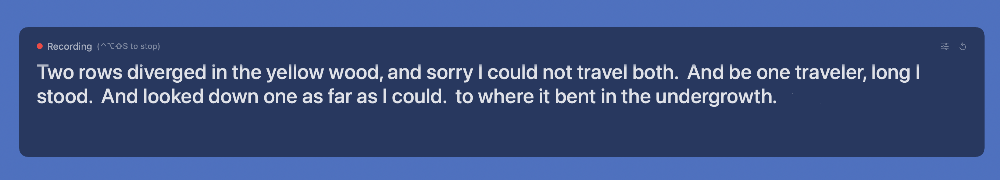
  <figcaption>字幕オーバーレイ — フローティング字幕として表示されるリアルタイム文字起こし</figcaption>
</figure>

リアルタイムの文字起こしをフローティング字幕オーバーレイとして表示します：

- **フローティング字幕** — すべてのウィンドウの上に表示
- **カスタマイズ可能** — フォントサイズ、不透明度、最大行数、位置
- **ドラッグ可能** — 上端のつまみをドラッグして字幕を移動
- **リアルタイム翻訳** — 話しながら字幕を翻訳（オプション）

ホットキー（デフォルト: `Ctrl + Option + S`）、STTパネル、またはメニューバーから切り替えます。

字幕には現在の録音セッションの文字起こしのみが表示されます。以前のセッションは表示されません。

### 字幕の翻訳

字幕オーバーレイで直接リアルタイム翻訳を有効にできます：

1. 字幕ヘッダーの地球儀アイコン（🌐）をクリックして翻訳を有効化
2. ドロップダウンメニューからターゲット言語とプロバイダを選択
3. 翻訳されたテキストが元の文字起こしの下に表示される

翻訳設定は字幕モード開始時にSTTパネルから同期されます。字幕オーバーレイ内で独立して変更することもできます。

## クイック入力

<figure>
  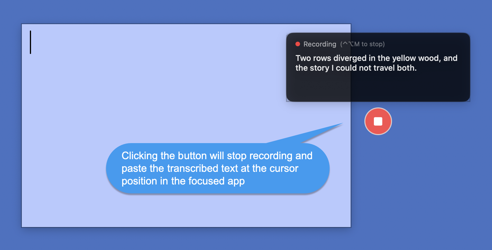
  <figcaption>クイック入力 — ボタンをクリックすると録音が停止し、文字起こしテキストがカーソル位置にペーストされます</figcaption>
</figure>

STTパネルを開かずに音声入力を行うフローティングマイクボタン。任意のアプリケーションへの素早い音声入力に最適です。

### 使い方

1. メニューバーから**Floating Mic Button**を有効にする
2. ボタンをクリックするか`Ctrl + Option + M`を押して録音開始
3. 話す — リアルタイムの文字起こしがボタン横のフローティングHUDに表示される
4. 再度クリックするか`Ctrl + Option + M`を押して停止
5. 文字起こしテキストが最前面のアプリに自動的にペーストされる

### 機能

- **フローティングボタン** — 48pxの丸型ボタン、常に画面上に表示
- **ドラッグ可能** — 任意の位置にドラッグ可能、位置はセッション間で保存
- **リアルタイムHUD** — 話しながら文字起こしテキストを表示
- **自動ペースト** — 録音停止時に文字起こしテキストがペーストされる
- **コンテキストメニュー** — 右クリックでSTTプロバイダの切り替えやボタンの非表示が可能

### ボタンの状態

| 状態 | 外観 |
|------|------|
| 待機中 | マイクアイコン付きの灰色ボタン |
| ホバー | アクセントカラー |
| 録音中 | パルスアニメーション付きの赤、停止アイコン |

ボタンのツールチップには現在のショートカットと録音時間が表示されます。

## 翻訳

<figure>
  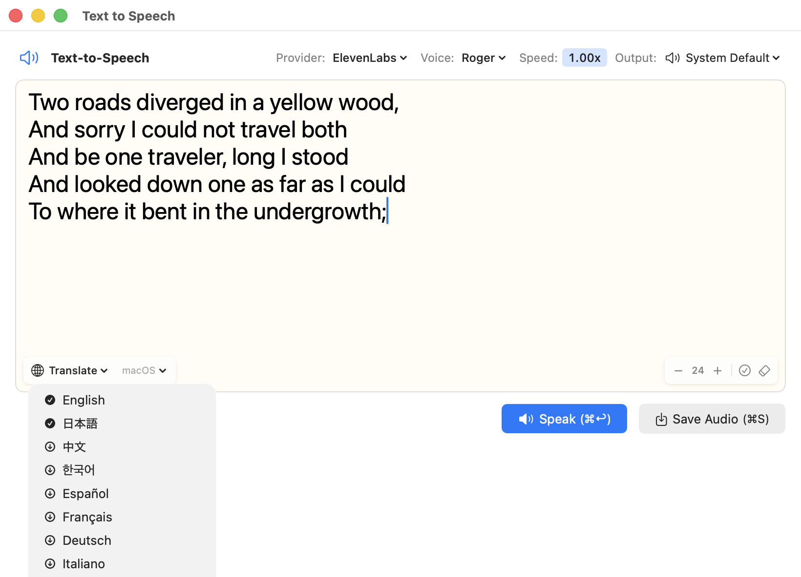
  <figcaption>翻訳コントロール — ワンクリックでテキストを翻訳</figcaption>
</figure>

macOSのオンデバイス翻訳を使用して、文字起こしテキストやTTSテキストを翻訳します（macOS 26以降が必要）。APIキー不要で、約18言語に対応しています。

### 使い方

1. STTまたはTTSパネルでテキストを入力または文字起こし
2. 言語ドロップダウン（例: `→ Japanese ▼`）からターゲット言語を選択
3. `[🌐 Translate]`をクリックしてテキストを翻訳
4. `[🌐 Original ◀]`をクリックして元のテキストに戻す

翻訳コントロールはテキストが3文字以上あり、録音/再生中でない場合に表示されます。言語選択と翻訳実行は別々の操作なので、翻訳を実行せずにターゲット言語を変更できます。

**TTS言語の同期**: テキストを翻訳すると、TTS言語が翻訳先の言語に自動的に切り替わります。元に戻すと、以前のTTS言語が復元されます。

その他の翻訳オプション（100以上の言語、高品質）については、[高度な機能](advanced_ja.md#外部プロバイダによる翻訳)を参照してください。

## テキスト置換

STT出力やTTS入力のパターンを自動的に修正・置換するルールを定義します。

### 組み込みパターン

| パターン | 例 | デフォルトの置換 |
|----------|----|--------------------|
| URL | `https://example.com` | " URL " |
| メールアドレス | `user@example.com` | " Email " |
| ファイルパス | `/path/to/file` | " Path " |

各パターンはオン/オフを切り替えでき、置換テキストをカスタマイズできます。

### カスタムルール

**設定** > **テキスト置換**で独自の正規表現ベースの置換ルールを追加します。ルールはJSONファイルとしてエクスポート/インポートできます。

TTSパネルでは、マッチしたテキストがオレンジ色の下線とツールチップでハイライト表示されます。

## キーボードショートカット

### グローバルホットキー

| 操作 | デフォルト |
|------|-----------|
| STTパネルの切替 | `Cmd + Shift + Space` |
| TTSパネルの切替 | `Ctrl + Option + T` |
| OCR領域から読み上げ | `Ctrl + Option + Shift + O` |
| 字幕モードの切替 | `Ctrl + Option + S` |
| クイック入力 | `Ctrl + Option + M` |

**設定** > **ショートカット**でカスタマイズできます。

パネル内で `?` を押すとキーボードショートカットのチートシートが表示されます：

<figure>
  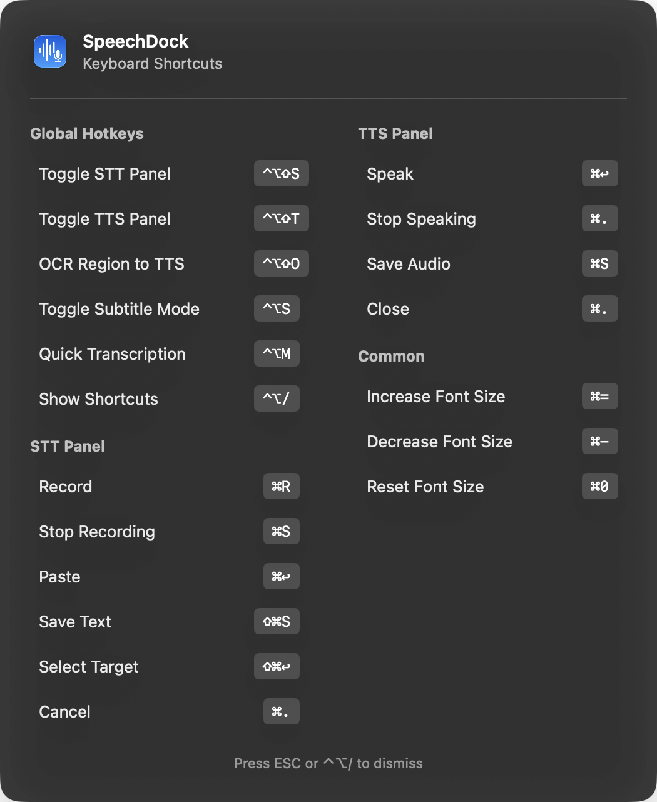
  <figcaption>キーボードショートカット チートシート</figcaption>
</figure>

### パネルショートカット

パネルショートカットは**設定** > **ショートカット**で修飾キーのサポート付きでカスタマイズできます。

## パネルスタイル

**設定** > **外観**で選択：

- **フローティング** — 常に最前面のボーダーレスパネル。上端のつまみをドラッグして移動
- **標準ウィンドウ** — 通常のmacOSウィンドウ。タイトルバーをドラッグして移動

一度に開けるパネル（STTまたはTTS）は1つだけです。一方を開くともう一方は閉じます。

## メニューバー

<figure>
  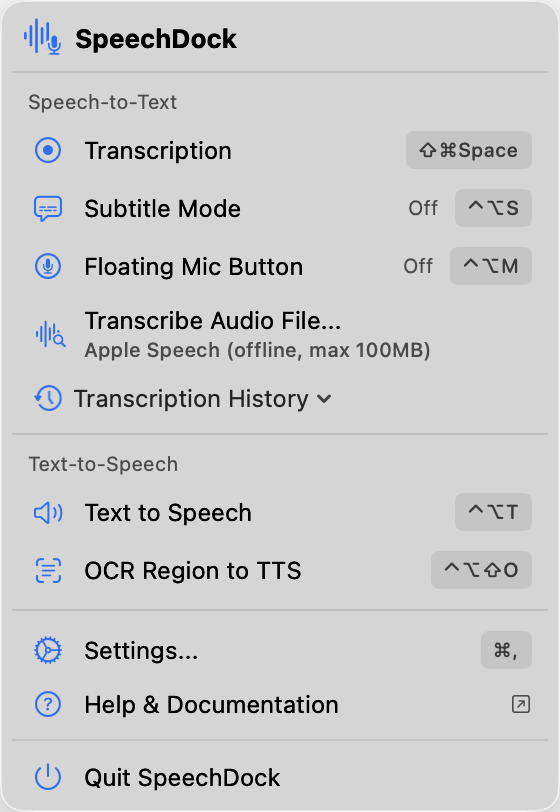
  <figcaption>メニューバー — すべての機能へのクイックアクセス</figcaption>
</figure>

メニューバーのSpeechDockアイコンをクリックして以下にクイックアクセス：

- STT録音の開始/停止
- 選択テキストのTTSを開く
- 字幕モードとフローティングマイクボタンの切替
- 音声ファイルの文字起こし
- 文字起こし履歴の閲覧
- OCR読み上げ
- 設定、ヘルプ、Aboutにアクセス

## 設定

`Cmd + ,` またはメニューバーから設定を開きます。統合設定ウィンドウはサイドバーで以下のカテゴリに分かれています：

<figure>
  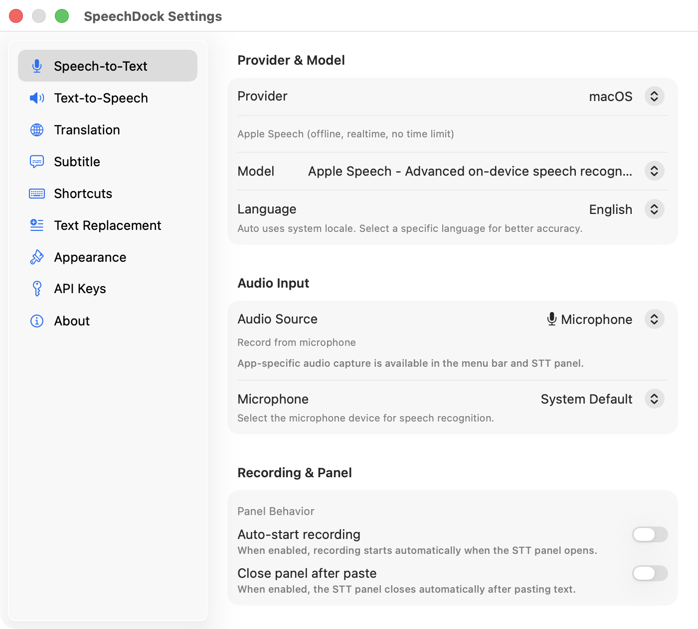
  <figcaption>音声認識 — プロバイダ、モデル、言語、音声入力、自動停止、パネル動作</figcaption>
</figure>

<figure>
  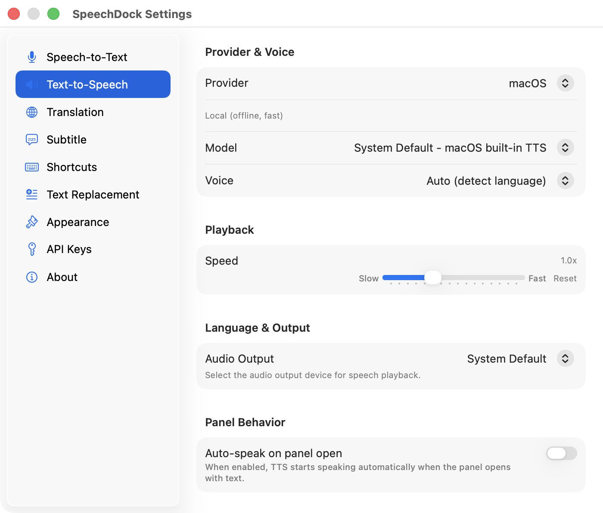
  <figcaption>音声合成 — プロバイダ、モデル、音声、速度、音声出力、パネル動作</figcaption>
</figure>

<figure>
  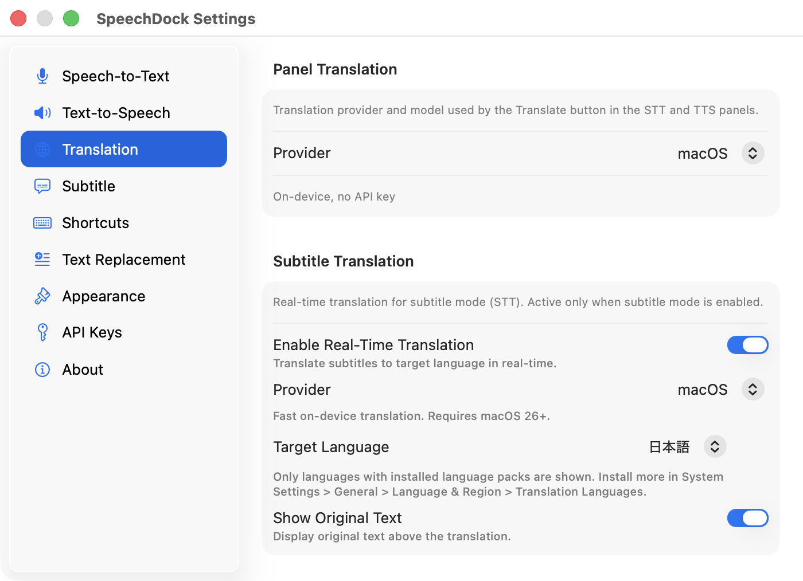
  <figcaption>翻訳 — パネル翻訳プロバイダ/モデル、字幕翻訳設定</figcaption>
</figure>

<figure>
  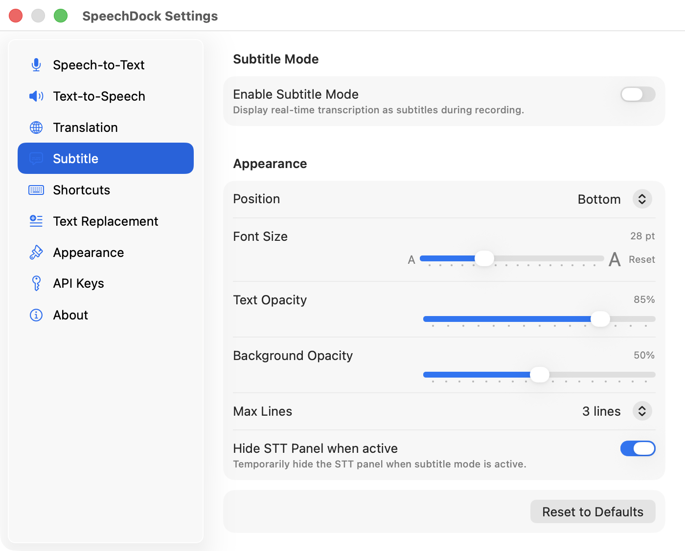
  <figcaption>字幕 — オン/オフ、位置、フォントサイズ、テキスト/背景の不透明度、最大行数</figcaption>
</figure>

<figure>
  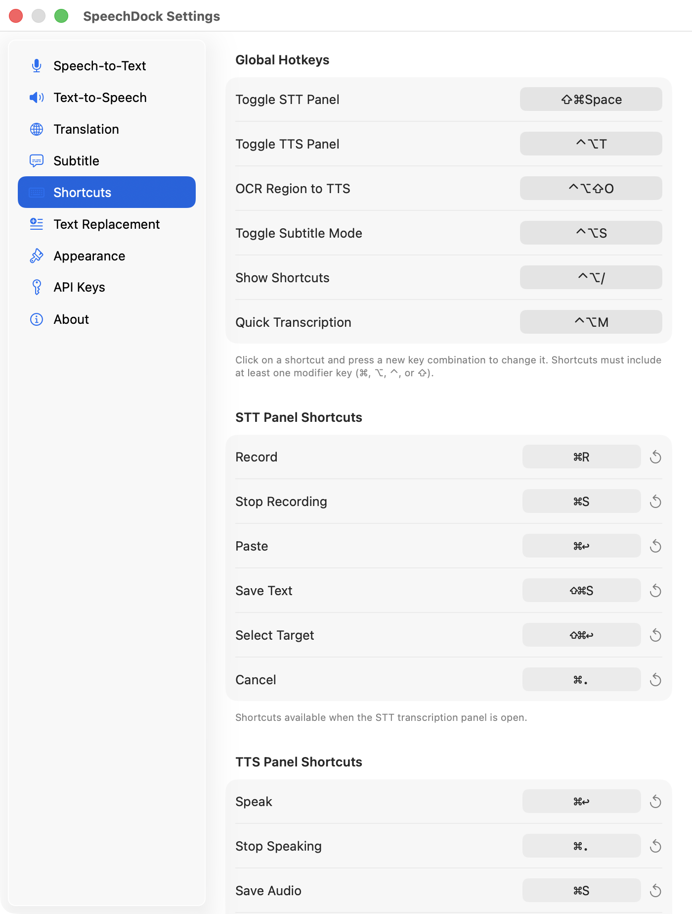
  <figcaption>ショートカット — グローバルホットキーとパネルショートカット</figcaption>
</figure>

<figure>
  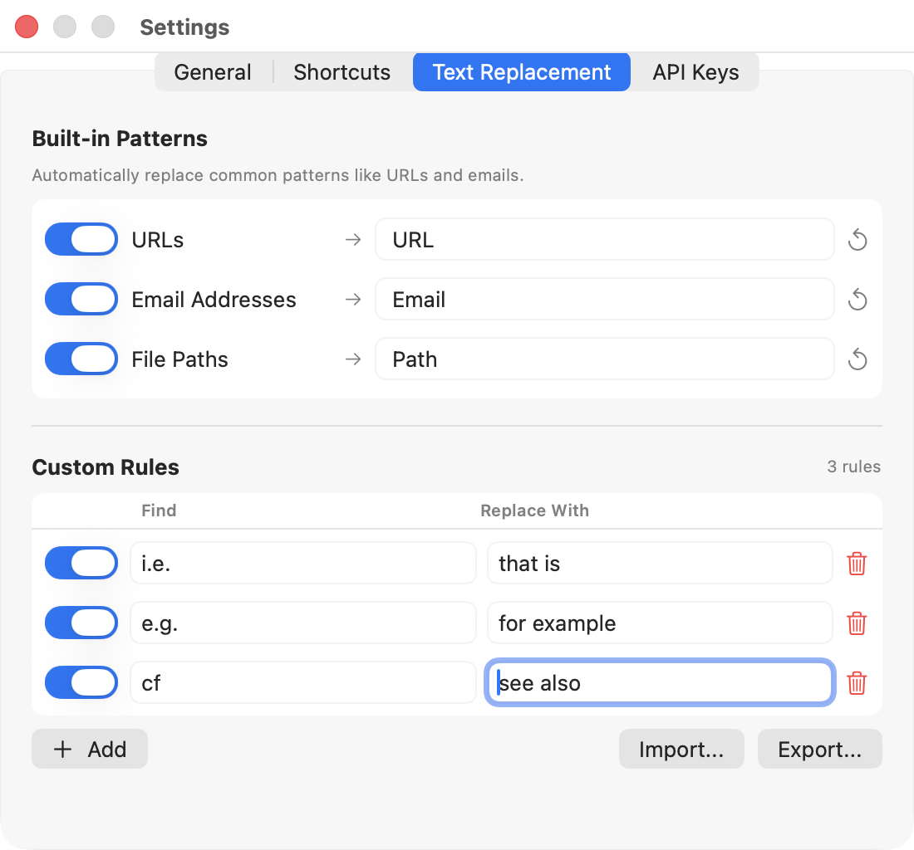
  <figcaption>テキスト置換 — 組み込みパターンとカスタムルール</figcaption>
</figure>

<figure>
  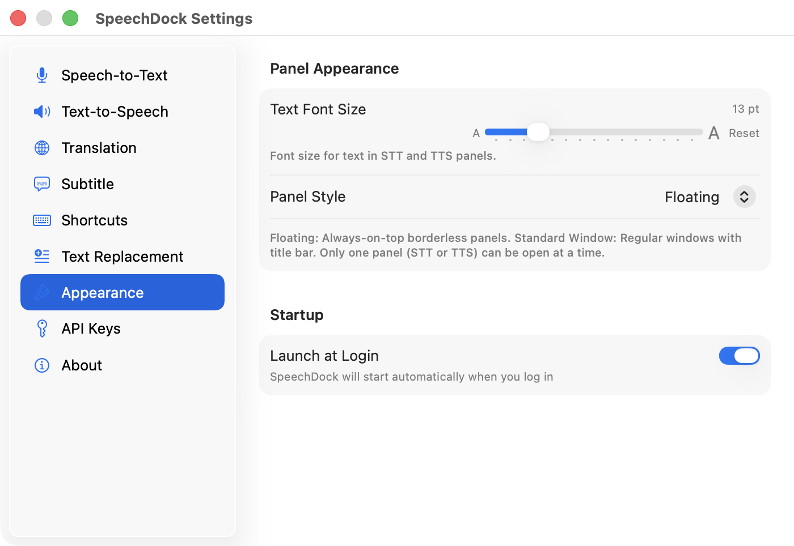
  <figcaption>外観 — テキストフォントサイズ、パネルスタイル、ログイン時に起動</figcaption>
</figure>

APIキーの設定については[高度な機能](advanced_ja.html)を参照してください。

## プライバシーとセキュリティ

- **macOSネイティブ**: すべての音声処理はデバイス上で行われます。外部にデータは送信されません。
- **APIキー**: macOSキーチェーンに保存され、各プロバイダ以外には送信されません。
- **テレメトリなし**: SpeechDockは使用状況データを収集・送信しません。

## トラブルシューティング

### STTが動作しない

1. マイク権限が付与されているか確認
2. システム音声/アプリ音声の場合、画面収録権限を確認
3. アプリを再起動してみる

### TTSが動作しない

1. 音声出力がミュートされていないか確認
2. 別の出力デバイスを選択してみる
3. アプリを再起動してみる

### ショートカットが反応しない

1. アクセシビリティ権限が付与されているか確認
2. 他のアプリケーションとの競合を確認
3. 設定でショートカットをデフォルトにリセット

### OCRが動作しない

1. 画面収録権限が付与されているか確認
2. より大きな領域で、より鮮明なテキストを選択してみる

---

**前へ**: [ホーム](index_ja.md) | **次へ**: [高度な機能](advanced_ja.md)
